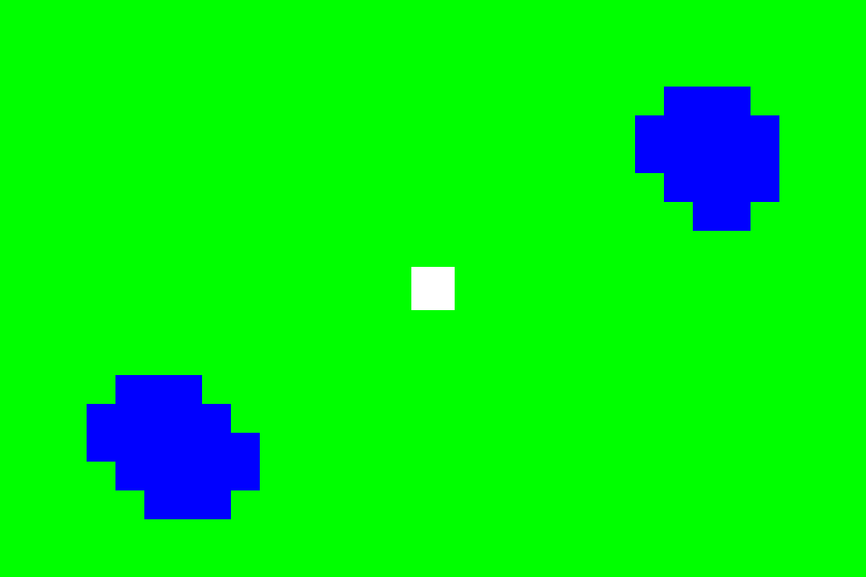

# Team Project

Please keep this up-to-date with information about your project throughout the term.

The readme should include information such as:
- a summary of what your application is all about
- a list of the user stories, along with who is responsible for each one
- information about the API(s) that your project uses
- screenshots or animations demonstrating current functionality

By keeping this README up-to-date,
your team will find it easier to prepare for the final presentation
at the end of the term.

# Project Name
SpellBook

## Team Information

### Team Members
- Aayaan Singal

- Omer Sheaffer

- Jordan Lin

- Seran Naventhan

## Project Description
A wave based game where the user can draw patterns to cast spells onto waves of enemies. Throughout the game, the user can get upgrades and get more spells through chests, to fight more difficult enemies until all the waves are defeated, or the user loses all their life.

### Domain

Game, RPG, Single Player, Offline, RogueLike

---

## User Stories

### User Story 1
As a player, I want to be able have a character that can move, interact and get stronger so that I’m able to fight enemies

### User Story 2
As a player, I want to be able to fight mobs (monsters) as well as traverse and explore the world so that they can progress in our game

### User Story 3
As a player, I want to be able use spells by drawing them so that I can fight enemies conveniently

### User Story 4
As a player, I want to be able to explore the map so I can fight new enemies, and get more rewards

#### Current map MVP — Seran Naventhan
As a player, I want to enter a world with visible dirt and water terrain so that I can see the arena where I will play.

### User Story 5
As a user, I want to be able to log in so that I can save my data across multiple devices

### User Story 6
As a player, I want to save a run card showing my stats and a snapshot of the dungeon after each run so I can keep it or share it with friends.

---

## Use Cases

### Use Case 1
Name: Move the Player

Primary actor: User

Preconditions:
The user is in the game loop, and not the login screen
The player is alive (hp is not less than or equal to 0)
Where the user is walking into is not a wall, or a blocked square

Trigger: The user presses the movement keys, which is w to move up, a to move left, s to move down, and d to move right

Success Outcome: The player moves to the tile corresponding to the key they pressed

Main success scenario:
The user presses one of the movement keys
The system checks that the tile they are moving to is an allowed tile to move to
The player’s coordinate is updated
The player sprite is updated and displayed to the user

Extensions:
2a: The tile they are moving to is a wall
The system recognizes that its a wall
The player stays in place

### Use Case 2
Name: Generate Mob Waves

Primary Actor: Player

Preconditions:
- The player is in an active game.
- No wave of mobs is currently active.

Trigger: The player makes their first movement in the game. (Every later wave is triggered by the previous wave being defeated.)

Success outcome: A wave of mobs appears inside the world, away from the player, and chases the player wherever they go, stopping when it reaches them. Once that wave is defeated, the next wave appears.

Main Success Scenario:
1. The player presses a movement key for the first time.
2. The game places a wave of mobs inside the world, near its edges, without any mob overlapping the player or another mob.
3. The game shows the current wave number.
4. Every update, each mob moves toward the player's current position, no faster diagonally than straight.
5. A mob that reaches the player stops right beside them, without overlapping them.
6. When the player moves away, the mob starts chasing again.
7. When every mob in the wave has been defeated, the game places the next wave and the wave number goes up by one.

Extensions:
- 1a. The player presses no movement keys, or only opposite keys that cancel out (left and right together).
  1. Nothing appears and the game keeps waiting for a real movement.
- 2a. There is not enough free space in the world to place the whole wave.
  1. No mobs appear (the game never places part of a wave).
  2. The game tells the player the wave could not start.
  3. The game tries again on the next update, and the player can keep moving meanwhile.
- 5a. The player walks into a mob that is already beside them.
  1. The mob stays where it is; it does not push the player or move through them.
- 7a. At least one mob in the wave is still alive.
  1. No new wave appears.

MVP scope (November 2026): mobs cannot be defeated yet, because combat (Use Case 4) is not built.
Touching the player does not hurt the player or defeat the mob. The first wave therefore stays
on screen; step 7 is ready for combat to plug into and is covered by automated tests.

Planned (after the MVP, once health and combat exist):
- Mobs damage the player on contact.
- Later waves get bigger or harder, and new kinds of mob appear.
- 4a. The player is defeated by the mobs: the player is shown the death screen and can restart the game.

### Use Case 3

Name: Prepare a Spell

Primary actor: Player

Preconditions: The player is in an active game and has drawn one or more strokes while holding the drawing key.

Trigger: The player releases the drawing key to submit the gesture.

Success outcome: The game recognizes the gesture and automatically starts casting the identified spell in the direction of the captured drawing location.

Main success scenario:
1. The player releases the drawing key.
2. The game captures the completed gesture and its fixed aim point in the world.
3. The game recognizes a supported spell while the interface remains responsive.
4. The game automatically continues to Cast a Spell with that spell and aim point.

Extensions:
- 2a. The submitted gesture is empty. The game shows feedback and launches nothing.
- 3a. Recognition fails or identifies an unavailable spell. The game shows feedback and launches nothing. The player can draw again.

### Use Case 4

Name: Cast a spell

Primary Actor: Player

Preconditions: The player is in an active game, and a supported spell and fixed world aim point have been supplied.

Trigger: A successful spell recognition result arrives. During development of the recognition system, a left click supplies the equivalent fireball request.

Success Outcome: One animated projectile launches from the player's current centre and travels in a fixed direction toward the supplied aim point.

Main Success Scenario:
1. The game receives a spell and fixed world aim point.
2. The game checks that the spell and aim point are valid.
3. The game launches one projectile from the player's current centre.
4. The projectile travels at a constant velocity in its initial direction.
   Its flight animation repeats and faces the direction of travel.
6. On enemy contact, flight ends and a circular impact animation plays once at the collision location. The enemy remains active.
7. If the projectile leaves the world, it disappears without an impact animation.

Extensions:
- 2a. The spell is unavailable or the aim point is invalid. The game shows feedback and launches nothing.
- 2b. The aim point coincides with the launch centre. The game shows feedback and launches nothing.
- 4a. An enemy or the cursor moves. The projectile continues in its original direction.
- 4b. The projectile passes through the original aim point. It continues travelling in its original direction.

**MVP scope** The aim point determines the projectile's initial direction. The projectile continues until enemy contact or world exit. Enemy contact produces one visual impact, which disappears after its animation finishes. Health, damage, and enemy defeat are planned for later combat work.

### Use Case 5
Name: Enter the world

Primary Actor: Player

Owner of the current map MVP: Seran Naventhan

Preconditions: The game is available to start, and the player is not in an active run.

Trigger: The player starts a game.

Success Outcome: The player sees the complete dirt-and-water arena at its original tile size.

Main Success Scenario:
1. The player starts a game.
2. The game obtains the terrain for the starting arena.
3. The player sees the complete arena, ready for play.

Extensions:
- 2a. No arena is identified: the player sees an explanation that an arena is required. No new arena is shown.
- 2b. The arena is unavailable or cannot be read: the player sees a loading error. No new arena is shown.
- 2c. The arena is empty or contains invalid terrain: the player sees an error explaining the problem,
  including its location when available. No partial arena is shown.
- 3a. The arena cannot be displayed: the player sees an explanation, and any previous complete
  arena stays visible. A partially drawn replacement is not shown.

On any failure, an already displayed arena remains unchanged. A later successful attempt replaces
it and clears the error.

Implementation status: the loading flow, production map, placeholder tile images and cached
renderer are connected to startup and the game panel. Startup failures show an error dialog
without opening a playable game; later map errors appear above the last complete background.
Automated tests cover the startup builder, panel drawing and existing movement controls.
Final verification is complete; the live display and keyboard checks were confirmed by Seran.
Enemy spawning, player collision and camera behaviour are outside this map MVP.

### Use Case 6
Name: Save Run Card

Primary Actor: Player

Preconditions: The player has finished a dungeon run. The game has captured the dungeon snapshot and logged the final run stats.

Trigger: The player clicks on “Save Run Card”

Success Outcome: A PNG run card containing the dungeon background and final run statistics is saved to the player’s chosen location.

Main Success Scenario:
1. The game opens a file save dialogue and suggests `dungeon-run.png`.
2. The player chooses a destination and confirms the save.
3. The game shows that the card is being generated and requests a finished image from PageShot. The card includes the dungeon background, a gradient overlay, the player’s display name/username, score, enemies defeated, time survived, and waves survived.
4. The game receives the finished PNG and saves it to the chosen destination.
5. The game displays a preview and confirms where the card was saved.

Extensions:

2a — The player cancels the save dialogue.

1. The player returns to the results screen.
2. The game makes no request to PageShot and creates no file.
3. The player can select “Save Run Card” again.

2b — A file already exists at the chosen destination.

1. The game asks whether the player wants to replace it.
2. If the player declines, they can choose another destination or cancel.

3a — PageShot fails to return a usable image.

1. The game reports that the card could not be generated.
2. The game retains the same background and final statistics so the player can retry.
3. No file is saved.

4a — The game cannot save the PNG.

1. The game reports that the card could not be saved.
2. The player can choose another destination using the image already generated.

---

## Minimal Viable Product (MVP)

| Team Member | MVP Use Case |

|-------------|--------------|

| Jordan Lin | Move the Player |

| Seran Naventhan | Generate the World |

| Seran Naventhan | Save Run Card |

| Aayaan Singal  | Generate Mob Waves |

| Omer Sheaffer | Cast a Spell |

| Omer Sheaffer | Prepare a Spell |

Current milestone ownership is recorded in `docs/specs/enemy-and-fireball.md`: Seran owns the
tile-map portion of Enter the World. The table above records the earlier project allocation.

---

## Entities

### Entity 1: Player
Represents the person-controlled character.

Instance variables:
- int health — current health.
- Position position — current location in the world.
- List<Spell> unlockedSpells — spells the player can cast.

Relevant methods:
- move(Position destination) — changes the player’s position.
- castSpell(Spell spell, Position position) — Release a spell towards the given position
- takeDamage(int amount) — reduces the player’s health.
- isAlive() — returns whether the player has health remaining.

### Entity 2: Spell
Represents a spell and the drawing pattern used to activate it.

*Implemented for the MVP:* Spell defines getId() and getName(), and FireballSpell provides the fireball identifier and display name. Damage and applyEffect(Enemy) remain **planned** for a later combat feature.

Instance variables:
- String name — spell’s name.
- int damage — damage dealt to affected enemies.

Relevant methods:
- cast(Position location, World world) — activates the spell at the specified location.
- applyEffect(Enemy enemy) — applies the spell’s damage or other effects to an enemy.

### Entity 3: Enemy
Represents an enemy spawned during a wave.

*Implemented for the MVP:* `entity/Enemy` (position, hitbox size, speed in pixels per tick,
straight-line chase that stops at first contact), `entity/EnemyWave` (wave number and active
enemies) and `entity/Hitbox` (pure rectangle geometry with the contact rule). Health, attack
damage, attack range, enemy types and `takeDamage`/`isAlive` below are still **planned**.

Instance variables:
- String enemyId — unique identifier for the enemy.
- String enemyType — enemy category, such as basic, fast, or boss.
- int health — current health.
- int attackDamage — damage dealt by an attack.
- double movementSpeed — speed at which the enemy moves.
- double attackRange — maximum distance at which the enemy can attack.
- Position position — current location in the world.
Relevant methods:
- moveToward(Position target, double deltaTime) — moves toward a target based on elapsed time.
- canAttack(Player player) — checks whether the player is within attack range.
- attack(Player player) — damages the player.
- takeDamage(int amount) — reduces the enemy’s health.
- isAlive() — returns whether the enemy has health remaining.

Entity 4: World
Represents the game map and manages enemies, spell placement, and wave progression.

Instance variables:
- double width — map width.
- double height — map height.
- Player player — player currently in the world.
- List<Enemy> activeEnemies — enemies currently on the map.
- List<Position> spawnLocations — possible enemy spawn locations.
- int currentWave — current wave number.
- boolean encounterStarted — whether the player has started the first wave.

Relevant methods:
- isWaveComplete() — checks whether the current wave’s completion condition has been met.
- getEnemiesInRange(Position location, double radius) — finds enemies affected by a spell.
- isWithinBounds(Position location) — checks whether a location is inside the map.

Position is a custom class describing their x and y coordinate.
(Add additional entities as needed.)

---

API ideas:
https://goqr.me/api/doc/create-qr-code/ (share good run score as qr code)
https://wiki.openstreetmap.org/wiki/Overpass_API? (gen new random world each game using irl places and mapping irl structures to in-game obstacles)
https://pageshot.site/docs (share dungeon run png. We give it a snapshot of the dungeon + the run stats as text + a color gradient to overlay above the snapshot and below the text. It formats it as a single png image and returns it)

## API Usage

**API Name:** PageShot API

**Documentation**: [PageShot API documentation](https://pageshot.site/docs)

**How it is used in the program**:
The player can generate a shareable PNG image summarizing their dungeon run. The program captures a snapshot of the dungeon and builds an HTML/CSS template containing the snapshot, a colour gradient overlay, and text showing the player’s username, score, and waves survived. It sends this template to PageShot’s /v1/html endpoint, which renders the layout into a single PNG image. The game then displays the image and allows the player to save it for sharing.

**API Name**: goQR.me QR Code API

**Documentation**: https://goqr.me/api/doc/create-qr-code/

**How it is used in the program**:
After completing a run, the player can generate a QR code to share their results. The program sends a short text summary containing the player’s username, final score, and number of waves survived to the API. The API returns a QR code image, which the game displays and allows the player to save to clipboard. Other people can scan the code to read the run statistics.

---

## Design Diagrams

### UML Class Diagram

- Generate Mob Waves: [`docs/diagrams/generate-mob-waves.puml`](docs/diagrams/generate-mob-waves.puml)
  (first diagram; arrows are source-code dependencies and all point inward).

### Sequence Diagrams

- Generate Mob Waves, one tick: same file, second diagram (arrows are runtime calls).

---

## How to Run

Requires JDK 11+ (17 recommended).

- IntelliJ: open the project and run `app.Main`.
- Maven: `mvn compile exec:java -Dexec.mainClass=app.Main`, or `mvn compile` then `java -cp target/classes app.Main`.

Move the white box with WASD or the arrow keys over the green dirt and blue water map.
Your first move starts wave 1: three slimes appear near the edges and chase you, stopping
when they reach you. Player-water collision is deferred, so the player can cross water.
Enemy-water collision is also not wired into the enemy movement use case yet.

### Tests, coverage and style

- `mvn test` runs the JUnit 5 tests in `src/test/java` and writes a JaCoCo line-coverage report
  to `target/site/jacoco/index.html`.
- `mvn checkstyle:check` checks style against the course's shared Google rules
  (`checkstyle/google_checks.xml`). It reports without failing the build; see
  `checkstyle/checkstyle-suppressions.xml` for the two rules that clash with AGENTS.md
  (underscore package names and 4-space indentation).
- For environments without a desktop display, use `mvn -Djava.awt.headless=true test`.

### Architecture (core loop)

- `entity/Player`: position, size and speed (no Swing).
- `use_case/update_game`: one tick of game rules (`UpdateGameInteractor`) with input/output boundaries.
- `interface_adapter/game`: `GameController` (key state -> request), `GamePresenter` + `GameViewModel` (result -> what to draw).
- `view`: `GameWindow` (JFrame), `GamePanel` (draws), `KeyboardInput` (records held keys).
- `app`: `GameLoop` (60 ticks/s thread: input -> player update -> mob-wave update -> repaint) and `Main` (builds and wires everything).

### Architecture (Load Map, Seran)

Loads the terrain once at startup and prepares a cached map image, separately from the per-tick use cases.
The map MVP is implemented and verified, including startup and game-panel integration.

- `entity/TileType`: interface for immutable terrain types. `WaterTileType` has ID 0 and blocks walking; `DirtTileType` has ID 1 and permits walking.
- `entity/TileTypeRegistry`: resolves IDs through registered terrain objects and rejects duplicate or unknown IDs.
- `entity/TileMap`: an immutable grid of terrain objects, pixel-coordinate lookup and walkability (no Swing or file access).
- `use_case/load_map`: `LoadMapInputBoundary` and immutable `LoadMapInputData` accept a map name. `LoadMapInteractor` loads through `MapDataAccessInterface`, then sends an immutable `LoadMapOutputData` snapshot of tile IDs and tile size through `LoadMapOutputBoundary`. Invalid names and `MapLoadingException` failures go through the fail output; the input boundary returns `void`.
- `data_access/FileMapDataAccessObject`: loads UTF-8 resources from `maps/`, resolves IDs through the supplied terrain registry, and validates the tile grid.
- `interface_adapter/map`: `MapController` wraps the map name; `MapPresenter` converts success or failure into immutable `MapState`. `MapViewModel` stores that state and fires a `state` property-change notification. The map state contains IDs, dimensions and error text, with no entities, images or file APIs. A failed load preserves the previous map; success clears the error.
- `view/TileImageSource`: the view-only contract for looking up already loaded images by terrain ID. This is a rendering helper interface, not a use-case boundary.
- `view/TileSprites`: loads an injected mapping of IDs to classpath image resources once and checks their dimensions. Missing, unreadable or incorrectly sized images produce an `IOException` with the resource path; `MapBuilder` reports it through the startup error callback.
- `view/MapRenderer`: depends on `TileImageSource` and reads only `MapState`. It builds a cached image at the map's pixel dimensions, rebuilds when the grid or tile size changes, and preserves the last complete image if rendering fails. Loading/rendering error text is available through `getErrorMessage()`.
- `view/MapLayer`: reads `MapViewModel`, draws the cached background at the top-left, and wraps error text into a banner. `GamePanel` receives both map and enemy-wave layers. It draws terrain, enemies, the player and then any map error. It subscribes to map changes while displayed and removes its listener when detached.
- `view/GameWindow.showStartupError`: displays a failure dialog before a playable window is opened.
- `app/MapBuilder`: wires the map registry, file reader, use case, presenter and renderer; requests the starting map through `MapController`; and returns a prepared `MapLayer`. A map or image failure reports one error and returns no layer.
- `app/Main`: supplies `level1.txt`, tile size 32 and the image mappings to `MapBuilder`. It opens the window and starts the existing loop only after map preparation succeeds.

The map flow is separate from per-tick player updates. Interactor tests use in-memory data
access; an integration test connects the real file reader, controller, interactor, presenter
and renderer using the shipped resources. Startup wiring lives in `app`, and `GamePanel`
draws the cached image through `MapLayer`. Property-change listeners only request repainting,
which is safe from another thread; Swing paints and uses the renderer on its event thread.
The first paint reads the current state, including when loading finished before subscription.
Cached tile and map images are shared within the view and must be treated as read-only.

#### Map resource format

The file reader loads names such as `level1.txt` from `maps/` on the classpath, so it does not
depend on the current working directory. The production arena is
`src/main/resources/maps/level1.txt`; small test maps live in `src/test/resources/maps/`.

Each non-comment line is one row of integer tile IDs, separated by whitespace. With the MVP
terrain registry, `0` is water and `1` is dirt. Blank lines and lines whose first non-whitespace
character is `#` are skipped. Every tile row must have the same number of columns. The tile size
is supplied when constructing the reader; the production arena uses 32-pixel tiles.

Missing, empty, unreadable, or malformed maps produce `MapLoadingException`. Format errors
identify the map name, original file line, and tile column, counted from one. Columns count
tile entries, not characters. `LoadMapInteractor` catches loading failures and sends their
explanation to the presenter, which adds "Unable to load map:" to the view-model error text.
Startup displays that error in a dialog and does not start the loop. If a future reload fails
after startup, the panel displays the error above the previously rendered map.

#### Map resources and rendering

`level1.txt` has 30 columns and 20 rows, producing a 960 × 640 map at a tile size of 32.
The centre and outer edges are dirt, with two water areas elsewhere. The placeholder sprites
are `src/main/resources/tiles/dirt.png` (solid green, `#00FF00`) and
`src/main/resources/tiles/water.png` (solid blue, `#0000FF`), both opaque 32 × 32 PNGs.
`Main` supplies the mapping `0 -> /tiles/water.png`, `1 -> /tiles/dirt.png`.

The renderer reads the IDs supplied by the map view model and places each image in its tile
cell. It uses the map's dimensions rather than fitting the map to the window. Repainting the
same state reuses the cached image; error-only changes also reuse it. The helpers do not know
about player movement, enemy behaviour, fireballs or a camera.

To edit the map, change the numbers in `level1.txt` and rebuild resources before the next run
(for example, with `mvn compile`). Player collision and detailed tile artwork are deferred.
The terrain data marks water as non-walkable for the enemy feature to use; integrating enemy
movement is separate work. Fireballs should cross water.

#### Map verification

See the [map acceptance checks](docs/specs/enemy-and-fireball.md#final-verification-original-step-8)
for the evidence and steps to repeat the checks.

The image below is an offscreen render of the production `GamePanel`, using the shipped map
and tile images with the player at its starting position.

### Architecture (Generate Mob Waves, Aayaan)

Runs every tick right after the player moves, as its own use case.

- `entity`: `Enemy` (chases a target, stops at first contact), `EnemyWave` (wave number,
  active enemies, `removeEnemy` seam for future combat), `Hitbox` (rectangle geometry and the
  touching rule).
- `use_case/generate_mob_waves`: `GenerateMobWavesInteractor` (when a wave starts, placing a
  whole wave or none, chasing) with its input/output boundaries and data, the
  `GenerateMobWavesDataAccessInterface` (player and wave), `MobWaveSettings` (count, size,
  speed) and the `SpawnPositionStrategy` interface with `EdgeSpawnPositionStrategy`.
- `data_access`: `InMemoryEnemyWaveDataAccessObject` holds the shared player and the wave.
- `interface_adapter/enemy_wave`: `EnemyWaveController` (keys -> direction),
  `EnemyWavePresenter` (result -> rounded, immutable `EnemyWaveState`), `EnemyWaveViewModel`.
- `view`: `EnemyWaveLayer` (draws mobs and the wave heading inside `GamePanel`), `SlimeSprite`
  (chooses idle/walk frames, fits the art to the hitbox, mirrors it), `SpriteSheet` (loads a
  classpath PNG strip). Art: `src/main/resources/sprites/` (see `CREDITS.md` there).

Tunable defaults (in `Main`): 3 slimes per wave, 56 x 34 px hitbox (the slime art at exactly 2x),
2 px per tick (half the player's speed), spawned 16 px inside the edges.

---

## Notes

[Any additional project information.]

