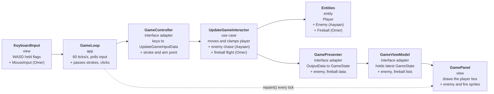

# SpellBook: Enemy, Spell & Map Spec

2026-11-16 · Jordan Lin

## Overview

This milestone adds the first enemy (Aayaan), the first spell, a fireball (Omer), and a tile map loaded from a text file (Seran), on top of the core loop that already moves the player with WASD. Everything below is a starting proposal: numbers and designs marked *proposed* are defaults to confirm or change when we talk them through (see Open questions).

| Owner | Feature | Branch (proposed) | Done when |
| --- | --- | --- | --- |
| Aayaan | Enemy that chases the player | `feat/enemy` | An animated enemy walks to the player and stops on contact |
| Omer | Fireball spell | `feat/fireball-spell` | Drawing a circle, then clicking, launches an animated fireball toward the click |
| Seran | Tile map from a text file | `feat/tile-map` | The game draws a dirt-and-water map read from a file of tile numbers |

All three features build on `feature/core-loop` (the movable player), which is open as PR #2 and not on `main` yet. Branch from it, or wait until it merges. Commits follow Conventional Commits, and each feature goes in by pull request with one teammate reviewing.

## How new features plug in

No feature needs a new architecture. The enemy and the fireball add to the same once-per-tick path the player already uses, so work through it in the order shown. The map is the exception: it loads once at startup through a new `data_access` package, and the tick path then reads it. Lines starting with `+` are new this milestone (proposed).



Key presses and mouse strokes are only recorded by the `view` layer. `GameLoop` reads them 60 times a second and calls the controller. The interactor applies the game rules to the entities, and the presenter turns the result into a `GameState` that `GamePanel` draws. Imports only point inward (`view` → `interface_adapter` → `use_case` → `entity`). The use case reaches the presenter only through the `UpdateGameOutputBoundary` interface.

## Aayaan: first enemy

> **Update (2026-11-20, Aayaan): scope changed from one enemy to mob waves.** The course
> needs each member to own a use case, so this became its own **Generate Mob Waves** use case
> (`use_case/generate_mob_waves`, README Use Case 2) instead of extra steps inside
> `UpdateGameInteractor`. What changed from the proposal below:
>
> - **Waves, not one enemy.** A wave of 3 slimes appears on the player's *first movement*
>   (not at startup), near the left, right and top edges. Only one wave is active at a time;
>   the next wave starts once every enemy in the current one has been removed.
> - **Removal seam for combat:** `EnemyWave.removeEnemy(enemy)`. Nothing calls it yet, so in
>   normal play wave 1 stays on screen. Touching the player does not kill an enemy.
> - **Tick order:** `GameLoop` calls the player's controller, then `EnemyWaveController`, then
>   repaints. A spell step can slot in between without touching either use case.
> - **Shared pieces delivered:** `entity/Hitbox` (axis-aligned boxes; edges and corners count
>   as touching) and `view/SpriteSheet` (loads a classpath PNG strip and cuts frames).
> - **Enemy display data** lives in its own `EnemyWaveViewModel`, not in `GameState`, so the
>   player and mob presenters never overwrite each other.
> - **Sprite:** the Tiny RPG pack's slime (`src/main/resources/sprites/enemy/slime/`), 6-frame
>   idle and walk strips of 100 x 100 frames; drawn at exactly 2x, so the hitbox is 56 x 34.
> - **Open questions answered:** no blocking terrain yet, so a straight-line chase is enough
>   (revisit if water blocks movement); art comes from the asset pack; speed is 2 px per tick
>   and enemies stop exactly at touching.
>
> The original proposal is kept below for history.

One enemy appears, walks toward the player using an animated sprite, and stops when it reaches them. It has no HP, does no damage and cannot die yet.

**Behaviour (proposed)**

- Spawns once at game start, at a fixed point near a screen edge, so it is easy to test.
- Moves toward the player every tick at 2 px per tick. That is half the player's 4 px, so the player can always outrun it.
- Stops when its hitbox touches the player's hitbox, and starts chasing again when the player moves away.
- Faces the direction it is moving (sprite flips left/right) and plays an idle animation while stopped.

**Pathfinding**

The world is currently an empty 960 × 640 px box with no walls. With nothing in the way, moving in a straight line toward the player is the shortest path. Step one is that straight-line chase. Real pathfinding, such as A\* over the 30 × 20 grid of 32 px tiles in Seran's `TileMap`, only matters once tiles block movement. If water blocks movement this milestone, the enemy needs it to get around lakes. That is an open question.

**Sprites**

- A walk animation and an idle animation, as PNG sprite sheets in `src/main/resources/sprites/enemy/`.
- Images are loaded and drawn only in the `view` layer. The `Enemy` entity knows nothing about images. It only exposes state the view needs: position, facing direction, and whether it is moving.
- The view picks the animation frame from that state plus a tick counter. For example, it could change frames every 8 ticks, which is about 7.5 frames per second.

**Where the code goes**

| Layer | Change |
| --- | --- |
| `entity` | New `Enemy` with position, size, speed, `moveToward(player)` and an overlap check |
| `use_case/update_game` | `UpdateGameInteractor` moves the enemy after the player each tick. `UpdateGameOutputData` gains the enemy's state |
| `interface_adapter/game` | `GameState` gains an enemy snapshot. `GamePresenter` fills it |
| `view` | `GamePanel` draws the enemy sprite. A small sprite-sheet loader is shared with Omer |
| `app` | `Main` creates the enemy (or a `GameWorld` that holds it) |

**Done when**

- [ ] The enemy spawns, walks to the player and stops on contact
- [ ] Walk and idle animations play, facing the right way
- [ ] Diagonal movement is not faster than straight movement
- [ ] A unit test drives `UpdateGameInteractor` with a fake presenter and checks that the enemy gets closer each tick and stops at contact

## Omer: first spell (fireball)

Cast a Spell is implemented independently of Prepare a Spell.

The projectile entity, launch use case, and shared in-memory storage are
implemented and unit tested. Simulation, input integration, and rendering
are the next implementation steps.

### Development input

A temporary left click supplies the fireball spell ID and a fixed world
reference point through the casting boundary. Each click requests one projectile.

### Future preparation integration

Prepare a Spell owns drawing capture and recognition. The player holds a
drawing key across mouse strokes and releases it to submit the gesture.
Successful recognition automatically supplies one spell ID and the captured
world reference point to Cast a Spell. Rejection produces feedback and
zero cast requests.

The proposed drawing reference point is its bounding-box centre.
The drawing key and final CNN or $P recognizer remain to be chosen.

### Projectile behavior

1. Launch from the player's current centre.
2. Calculate the initial direction using the supplied world reference point.
3. Maintain constant velocity, including after passing through that point.
4. On the first enemy contact, remove the projectile and emit one impact event
   containing the spell identity and collision position.
5. On world exit, remove the projectile without an impact event.

Enemy movement leaves the projectile's velocity fixed.
Health, damage, and enemy defeat remain deferred.

### Animation

The view owns image loading, frame selection, rotation, and animation timing.

The supplied fireball sheet contains seven visible frames in a 700 × 100 image.
Store the prepared resource under src/main/resources/sprites/spells/fireball/.

Proposed playback for visual verification:
- Loop frames 1–4 throughout flight.
- Play frames 5–7 once on enemy impact, ending with the circular frame.
- Start with five game ticks per frame and adjust after viewing it in-game.
- Remove the impact visual after its final frame has been displayed.

### Responsibilities

| Layer | Responsibility |
| --- | --- |
| entity | Projectile position, fixed velocity, and hitbox |
| use_case/cast_spell | Launch validation, movement, collision, expiration, and impact output |
| data_access | Shared player, enemy wave, and projectile storage |
| interface_adapter/cast_spell | Controllers, presenters, and immutable display state |
| view | Temporary input, flight animation, and impact playback |
| app | Dependency wiring and controller scheduling |

### Threading

Mouse events arrive on Swing's thread, but the game loop runs on its own thread. A finished stroke is a list of points, so it can't be shared through a `volatile` boolean the way WASD keys are. Hand it over through a thread-safe queue such as `ConcurrentLinkedQueue`, so a stroke is never read while it is still being built and never lost between ticks.

The completed-stroke handoff applies when Prepare a Spell is implemented.

For Cast a Spell, mouse input queues an immutable request containing the
spell ID and captured world aim point. The game loop processes each request
once through the casting controller. Projectile creation, movement, collision
checks, and removal happen on the game-loop thread. The view reads display
snapshots and renders flight and impact animations.

When Prepare a Spell is implemented, drawing recognition runs in a background worker. 
Successful recognition supplies a casting request through the same queue.

### Acceptance checklist

- [ ] One valid request launches one projectile.
- [ ] Movement speed is consistent in every direction.
- [ ] Flight continues beyond the original aim point.
- [ ] Collision detection catches enemies crossed between tick positions.
- [ ] Enemy contact produces exactly one impact event and preserves the enemy.
- [ ] World exit produces no impact event.
- [ ] Flight animation loops and impact animation plays once.
- [ ] Multiple projectiles and impact animations can coexist.
- [ ] Player movement and enemy pursuit continue working.
- [ ] Tests cover launch, simulation, expiration, and presentation.

## Seran: tile map

The world becomes a grid of 32 px tiles read from a text file where each number is one tile type: 0 = water, 1 = dirt. The 960 × 640 window holds exactly 30 × 20 tiles, so a screen-sized map is a file of 20 lines with 30 numbers each. The map loads once at startup. It is not part of the per-tick path.

**Map file format (proposed)**

- One file per map in `src/main/resources/maps/`, for example `level1.txt`.
- One line per row of tiles, with numbers separated by spaces. Spaces leave room for tile ids above 9 later.
- Lines starting with `#` are comments, and blank lines are skipped, so the file can carry notes.

Example: an 8 × 5 corner of a map with a lake on the right.

```
# 0 = water, 1 = dirt
1 1 1 1 1 0 0 0
1 1 1 1 0 0 0 0
1 1 1 1 1 0 0 0
1 1 1 1 1 1 0 0
1 1 1 1 1 1 1 1
```

**Tile design: keep images out of the tile**

An `image()` method on the tile class would mean the `entity` layer imports AWT image classes, which breaks the dependency rule. It would also stop tests from creating a map without the image files present. Instead, the entity says *what* a tile is, and the view decides *how it looks*:

```java
// entity/TileType.java
public enum TileType {
    WATER(0, false),
    DIRT(1, true);

    private final int id;
    private final boolean walkable;

    TileType(int id, boolean walkable) {
        this.id = id;
        this.walkable = walkable;
    }

    public boolean isWalkable() {
        return walkable;
    }

    public static TileType fromId(int id) {
        for (TileType type : values()) {
            if (type.id == id) {
                return type;
            }
        }
        throw new IllegalArgumentException("Unknown tile id: " + id);
    }
}
```

An enum fits because every water tile is identical. That way 600 tiles share 2 constants instead of being 600 objects, and adding a tile type is one line. If a tile later needs its own state, such as a door that opens, a `Tile` class can wrap a `TileType` plus that state.

**Where the code goes**

| Layer | Change |
| --- | --- |
| `entity` | `TileType` enum (above). `TileMap` holds a `TileType[][]` grid (rows × columns) and the tile size, with `getTile(col, row)`, `tileAtPixel(x, y)`, `isWalkable(x, y)` and width and height in pixels |
| `use_case/load_map` | `LoadMapInteractor` asks a `MapDataAccessInterface` for a map by name and passes the resulting `TileMap` to the game |
| `data_access` (new package) | `FileMapDataAccessObject` implements `MapDataAccessInterface`. It reads the text file and parses it into a `TileMap` |
| `interface_adapter` | A presenter sends the tile grid to the view once, after loading |
| `view` | `TileSprites` maps each `TileType` to its image, which is where `image()` lives. `GamePanel` draws the map before the player and enemy |
| `app` | `Main` creates the file data-access object and runs the map load before starting the loop |

**Parsing rules**

- Every row must have the same number of tiles.
- An unknown number stops loading with an error that names the line and column.
- A missing or empty file is an error too, so a mistake shows up at startup instead of as a blank screen.

**Drawing**

The map doesn't change between ticks, so don't copy it into `GameState` every tick. When the map loads, draw all its tiles once into a single 960 × 640 `BufferedImage`. Then `GamePanel` draws that one image each frame, which takes 1 draw call instead of 600.

**Walkable tiles (proposed second step)**

Once the map draws, stop the player from walking onto water. In `UpdateGameInteractor`, check the player's next position against `TileMap.isWalkable` at the four corners of its hitbox. If a corner lands on water, cancel the move on that axis. Checking x and y separately lets the player slide along a shoreline instead of sticking to it.

**Done when**

- [ ] `level1.txt` (30 × 20) loads, and dirt and water sprites draw behind the player
- [ ] Editing a number in the file changes the map on the next run, with no code change
- [ ] A bad file (uneven rows or an unknown number) stops with a clear error that names the line
- [ ] Unit tests parse a small map string into a `TileMap` and check `tileAtPixel` and `isWalkable`
- [ ] Second step: the player cannot walk onto water and slides along the shore

**Ideas for later**

- More tile types: 2 = stone wall, 3 = grass, 4 = sand
- Spawn markers in the file (for example 8 = player start, 9 = enemy spawn) that draw as dirt
- Maps bigger than the screen, with a camera that follows the player
- Randomly generated maps that write the same number format, so the loader doesn't change
- Shoreline edge tiles where dirt meets water (autotiling)

## Shared pieces and coordination

The enemy and the fireball both edit the same five files: `UpdateGameInteractor`, `UpdateGameOutputData`, `GameState`, `GamePresenter` and `GamePanel`. Agreeing on these shared pieces first avoids painful merge conflicts.

| Shared piece | Proposed owner | Why it is shared |
| --- | --- | --- |
| Hitbox overlap check (axis-aligned boxes) in `entity` | Aayaan | The enemy stops on contact, and the fireball disappears on hitting the enemy |
| Sprite-sheet loader in `view` (load PNG, cut frames, pick frame by tick) | Aayaan | Enemy and fireball are both animated |
| `GameState` shape: lists of enemy and fireball snapshots | Both, agreed up front | Both add fields to it and to `UpdateGameOutputData` |
| Order of steps inside one tick | Both, agreed up front | The fireball's hit check needs the enemy's position for that tick |
| Tile size (32 px) and `TileMap.isWalkable` | Seran | Player movement and the enemy's pathfinding both ask the map which tiles block them |

**Proposed tick order** inside `UpdateGameInteractor.execute`:

1. Move and clamp the player
2. Handle a finished stroke (ready a spell) and a click (launch a fireball)
3. Move the enemy toward the player, stopping on contact
4. Move fireballs and remove any that hit the enemy or left the screen
5. Send everything to the presenter

**Conventions to keep**

- Coordinates are pixels with the origin at the top-left, and y grows downward.
- Entities store positions as `double`. Only the presenter rounds to `int`.
- Entities never import Swing. The use case talks to the presenter only through `UpdateGameOutputBoundary`.

## Out of scope

These wait for a later milestone, so none of the three features should build them now:

- HP, damage and death, for both the player and enemies
- Waves, more than one enemy, and different enemy types
- Spells other than the fireball, plus mana and cooldowns
- Upgrades, chests and sound
- Maps bigger than one screen, a scrolling camera, and tile types beyond water and dirt

## Open questions

Settle these with Aayaan, Omer and Seran before coding starts, then tick each one off and update the sections above.

**For Aayaan**

- [ ] Does water block the enemy this milestone? If yes, it needs grid pathfinding (A\*) over Seran's `TileMap`. If no, a straight-line chase is enough.
- [ ] Where does the sprite art come from (made ourselves or a free asset pack), and what size are the frames?
- [ ] Is 2 px per tick the right enemy speed, and should it stop on touching or a few pixels before?

**For Omer**

- [ ] Simple circle check or the $1 Unistroke Recognizer?
- [ ] Does aiming fire on a separate click, or on the release of a second drag?
- [ ] Does a ready fireball expire after a few seconds if not used?
- [ ] A new `cast_spell` use case, or fold everything into `update_game`?

**For Seran**

- [ ] 32 px tiles, or 48 px to match the player? 640 px is not a whole number of 48 px rows (13.3).
- [ ] Does water block the player this milestone, or is the map only drawn for now?
- [ ] Do fireballs fly over water?
- [ ] Where does the tile art come from, and is each tile one 32 × 32 px image?
- [ ] Space-separated numbers, or one digit per tile with no spaces (shorter, but only 10 tile types)?

**For both**

- [ ] Does each person need their own use case for the course rubric? If yes, how do we split `update_game`?
- [ ] Should `Player`, `Enemy` and the fireballs move into a single `GameWorld` entity now, or later?
- [ ] Who writes the shared hitbox check and sprite loader, and by when?
